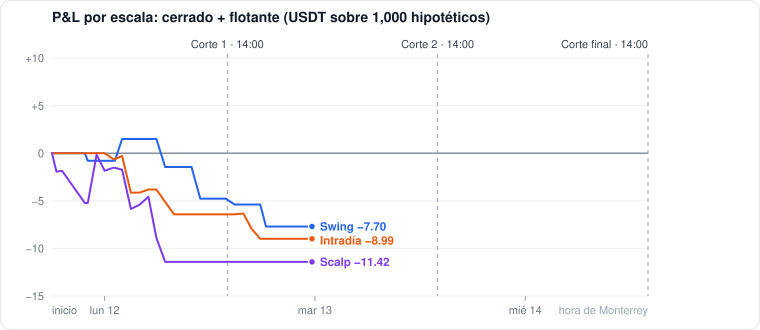

# CryptoAgent v4.1 — prueba en papel

> **Simulación con dinero hipotético.** No hay keys ni órdenes reales: el bot solo lee velas públicas de Binance y calcula qué habría hecho con las reglas congeladas.

**Actualizado:** mar 13 oct 02:41 (Monterrey) · velas hasta mar 13 oct 02:40 · fuente Binance (data-api.binance.vision)  
**Estado:** en curso — próximo corte: **Corte 2, mar 13 oct 14:00** (Monterrey)  
**Ventana:** dom 11 oct 18:00 → mié 14 oct 14:00 (Monterrey) · 8 monedas × 3 escalas · cuenta de 1,000 USDT por escala · 0.5% de riesgo por trade (1R ≈ 5 USDT) · comisión y slippage incluidos

**Las 3 escalas juntas (3,000 hipotéticos): −27.14 USDT** — cerrado −28.11, flotante +0.97, 10 trades cerrados, 3 posiciones abiertas.

## Resumen por escala

| Escala | Trades cerrados | Ganadas | Cerrado USDT | Flotante USDT | **Total USDT** | Abiertas | Señales de compra |
| --- | ---: | ---: | ---: | ---: | ---: | ---: | ---: |
| Swing (1D / 4H / 1H) | 2 | 0% | −7.70 | +1.37 | **−6.33** | 2 | 18 |
| Intradía (4H / 1H / 15m) | 3 | 0% | −8.99 | 0.00 | **−8.99** | 0 | 7 |
| Scalp (1H / 15m / 5m) | 5 | 0% | −11.42 | −0.40 | **−11.82** | 1 | 74 |

## Cortes

Cada corte se congela una sola vez al pasar su hora (no se reescribe).

| Corte | Hora (Monterrey) | Estado | Swing USDT | Intradía USDT | Scalp USDT | Trades cerrados |
| --- | --- | --- | ---: | ---: | ---: | ---: |
| Corte 1 | lun 12 oct 14:00 | guardado | −5.39 | −6.42 | −11.42 | 8 |
| Corte 2 | mar 13 oct 14:00 | pendiente | — | — | — | — |
| Corte final | mié 14 oct 14:00 | pendiente | — | — | — | — |

## Posiciones abiertas

Lo flotante ya descuenta la comisión de entrada y de salida: una posición apenas arriba de su precio de entrada todavía sale negativa.

| Escala | Moneda | Entrada (Monterrey) | Precio entrada | Precio actual | Stop | Objetivo | R flotante | USDT flotante |
| --- | --- | --- | ---: | ---: | ---: | ---: | ---: | ---: |
| Swing | BTC | lun 12 oct 22:00 | 83,372.8 | 83,870.9 | 81,727.3 | 87,486.6 | +0.18 | +0.69 |
| Swing | ETH | lun 12 oct 22:00 | 2,509.99 | 2,529.1 | 2,438.37 | 2,689.06 | +0.18 | +0.69 |
| Scalp | BTC | mar 13 oct 01:45 | 83,897.3 | 83,930 | 83,463.3 | 84,982.3 | −0.23 | −0.40 |

## Operaciones cerradas

| Escala | Moneda | Entrada | Salida | Precio entrada → salida | Motivo | R | USDT |
| --- | --- | --- | --- | ---: | --- | ---: | ---: |
| Intradía | BTC | lun 12 oct 14:00 | lun 12 oct 16:00 | 82,903.2 → 82,216.6 | stop | −1.05 | −2.57 |
| Swing | ETH | dom 11 oct 18:00 | lun 12 oct 14:00 | 2,538.21 → 2,488.64 | stop | −1.02 | −3.84 |
| Scalp | ADA | dom 11 oct 22:00 | lun 12 oct 06:30 | 0.250925 → 0.248318 | stop | −1.04 | −3.09 |
| Swing | BTC | dom 11 oct 18:00 | lun 12 oct 06:00 | 83,815 → 82,614.9 | stop | −1.03 | −3.87 |
| Intradía | ADA | lun 12 oct 00:00 | lun 12 oct 06:00 | 0.253727 → 0.248453 | stop | −1.02 | −3.83 |
| Scalp | LINK | lun 12 oct 04:00 | lun 12 oct 05:45 | 13.3917 → 13.2873 | stop | −1.05 | −2.45 |
| Scalp | BTC | dom 11 oct 20:00 | lun 12 oct 03:15 | 83,709.8 → 83,394.3 | stop | −1.09 | −1.44 |
| Intradía | BTC | lun 12 oct 02:00 | lun 12 oct 03:00 | 84,033.5 → 83,330.9 | stop | −1.05 | −2.59 |
| Scalp | BTC | dom 11 oct 18:00 | dom 11 oct 19:45 | 83,815 → 83,555.9 | stop | −1.11 | −1.27 |
| Scalp | ADA | dom 11 oct 18:00 | dom 11 oct 19:45 | 0.252326 → 0.249637 | stop | −1.04 | −3.16 |

## Por moneda

Cada moneda corrida sola con su propia cuenta (por eso no suma igual que el portafolio). R incluye lo flotante.

| Moneda | Swing | Intradía | Scalp | Buy & hold desde el inicio |
| --- | ---: | ---: | ---: | ---: |
| BTC | 1 tr · −0.85R (abierta) | 2 tr · −2.10R | 2 tr · −2.43R (abierta) | +0.19% |
| ETH | 1 tr · −0.84R (abierta) | — (0 señ.) | 1 tr · −1.06R | −0.14% |
| SOL | 1 tr · −1.02R | — (0 señ.) | — (0 señ.) | −2.54% |
| XRP | 1 tr · −1.02R | — (0 señ.) | — (0 señ.) | −2.24% |
| DOGE | — (0 señ.) | — (0 señ.) | — (0 señ.) | −2.21% |
| ADA | 1 tr · −1.01R | 1 tr · −1.02R | 2 tr · −2.08R | −5.31% |
| AVAX | — (0 señ.) | — (0 señ.) | — (0 señ.) | −5.04% |
| LINK | 1 tr · −0.89R (abierta) | — (0 señ.) | 2 tr · −2.09R | −2.39% |

## Línea base histórica (mismas reglas, antes de la ventana)

| Escala | Ventana | Trades | Ganadas | Expectativa | Profit factor | Retorno | IC95 expectativa |
| --- | ---: | ---: | ---: | ---: | ---: | ---: | --- |
| Swing | 365 días | 24 | 25% | −0.187R | 0.75 | −1.85% | [−0.74, +0.38]R |
| Intradía | 90 días | 62 | 32% | 0.000R | 1 | −0.50% | [−0.35, +0.37]R |
| Scalp | 30 días | 116 | 33% | −0.105R | 0.85 | −2.17% | [−0.34, +0.14]R |

Ninguna escala mostró ventaja en el histórico: el intervalo de confianza de la expectativa incluye 0 en las tres. Con pocos trades, lo de esta ventana es sobre todo ruido; el corte final se lee contra esta tabla.

Reglas congeladas: `forward/prerregistro.json` (hash del código 1b7510f0d80a2b6c). Motor: `forward/engine.js`. Datos crudos: `latest.json`, `corte_*.json`, `equity.csv`.
